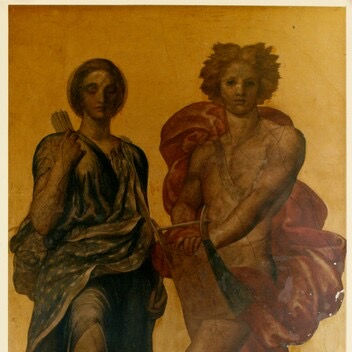
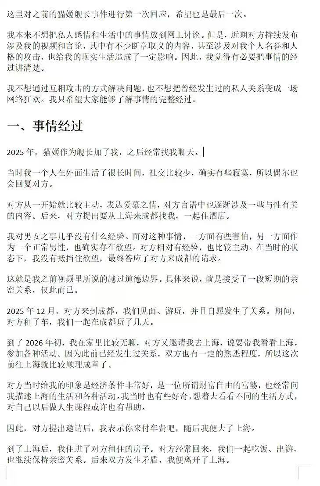
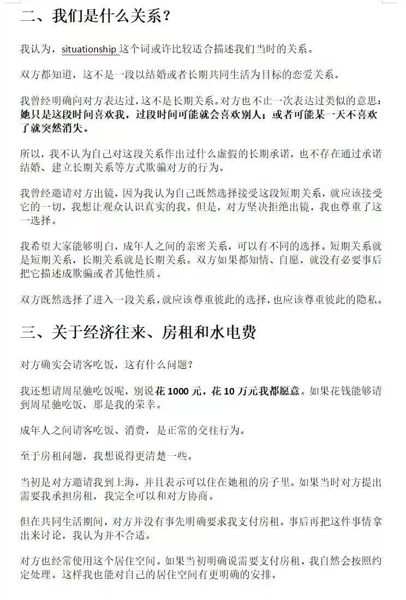
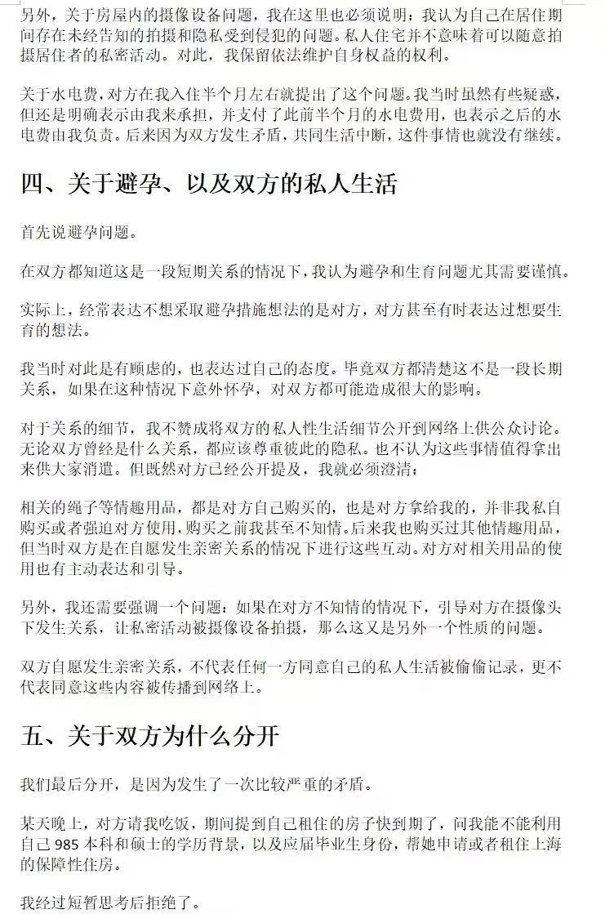
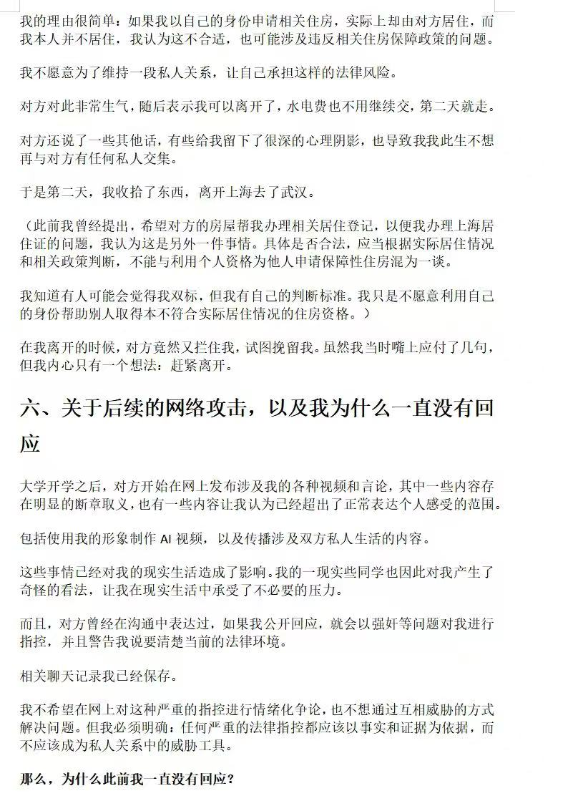
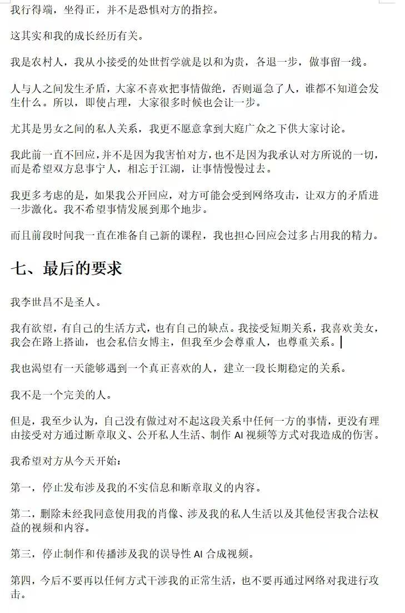
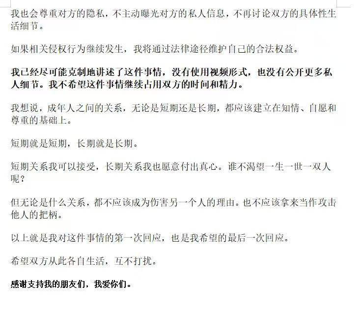

# 2026 年第 46 周

## 2026-11-09

神一定是有爱的

丘比特爱普续克
织女爱穷小子牛郎
……

都印证了神是有爱的

相反的 从来没有哪位哲学大师说过 或是规定过 神没有爱 他们普遍认为神的爱是一种 最高层次的爱 是 
无条件的 超越人类狭隘算计的创造与救赎

也印证了神是有爱的

娶亲先看娘 嫁夫先看家

古语云 不欺暗室 方为真善

祸福无门 为人自招

没有人能阻止我成为什么样的人 只有我自己能阻止我

## 2026-11-10

我对AI的看法

AI现在还只是一个写东西的工具 

他还不具备工程师对这个广博的世界的各种各样的理解和认识 

他做的项目 写的东西 

没有看出一点工程师的责任和担当 

做出来的东西也没有一点工程师的爱

现在的AI还只是机器 

我们有物理工程师 数学工程师 力学工程师 化学 材料 生物 土木 机械…..工程师 你湖也太厉害了

和AI聊这些的时候我只能说他太能编了 总体感觉就像跟木头人聊一样

（opus5.5 GPT6astra Gemini 4 argon）

## 2026-11-11

## 2026-11-12

流体力学期中考了84 这周末要接着考机械设计 理论力学和量子力学了 发发力孩子们 我要上90！

## 2026-11-13

继续发力 我要考100！

黄仁勋离开英伟达了 哎 老黄糊涂啊

在科班学完理论力学跟那些自学的民科是不一样的

湖大一年通过理论力学的不到200人

这个课只给我们学校的物理班和力学班开 总共就4个班 一个班30多人

一年还只开一次

只有排水1班和2班每年会开一次流体力学

那个流体力学也是 全湖大每年通过的不超过100人

那些自学理论力学的民科估计来考理论力学期中考试可能就考个几分吧 

我估计他们一上来做题 求导数都求不对

终于写完了 这量子力学作业阴完了

这微电子科学班真的不一般啊

跟数学的一对比就跟天人一样

真的 这作业是不是抄的 会的人一眼就能看出来 你写的时候明不明白每个式子的含义 自己在做什么 逻辑是什么 会量子力学的人一眼就能看出来作业是不是抄的 我认真写了一下就发现了 抄GPT的作业和自己认真写作业的区别太大了

这GPT写的东西现在越来越逆天了

他像一个全知全能的神 提前知道了所有答案 然后顺着答案直接把作业的每一步全部生成出来 而不是像学生 初学者一样 一步一步 老老实实的 踏踏实实 一步一步的算 一步一步慢慢顺着自己的逻辑自己推导

不行 得自己那啥了

我现在又next level了

我要让他顺着我的思路去想 给我做 而不是我顺着他的思路去想 学他想好的东西 而是要让他学我的思路

我发现这样比我以前学的效率高多了 我这样学 离开了GPT 他只是帮我突破了我原本思路上的障碍 然后合上电脑我也能真正用自己的思路把书上的公式 定理推出来 以前我老是学他的思路 总是去记他是怎么想的 做题的时候复现他的思路 发现有时候怎么都记不住他的思路 学习效果非常差 现在全都是我自己的思路了

这量子力学也是我们学校的那啥课

每年只有不到200人通过的课

只给材料专业的两个班 还有微电子物理的两个班开

每年只开一次

我量子力学 理论力学 材料力学 流体力学期末都要冲100分 我相信我肯定有这个实力

<video controls playsinline preload="none" width="852" height="480" poster="/thoughts/2026-W46/media/2026-11-13-vast-land-poster.jpg" aria-label="A vast land cannot breed narrow-minded love">
  <source src="/thoughts/2026-W46/media/2026-11-13-vast-land.mp4?v=0bb9f49b17ee" type="video/mp4">
  你的浏览器不支持视频播放，可<a href="/thoughts/2026-W46/media/2026-11-13-vast-land.mp4?v=0bb9f49b17ee">打开视频</a>观看。
</video>

<video controls playsinline preload="none" width="852" height="480" poster="/thoughts/2026-W46/media/2026-11-13-kang-hui-poster.jpg" aria-label="Kang Hui and his wife">
  <source src="/thoughts/2026-W46/media/2026-11-13-kang-hui.mp4?v=56af7fbe474e" type="video/mp4">
  你的浏览器不支持视频播放，可<a href="/thoughts/2026-W46/media/2026-11-13-kang-hui.mp4?v=56af7fbe474e">打开视频</a>观看。
</video>

kanghui and his wife 

kanghui loves his wife

有意思 这样翻译 感觉像是那种神笔马良 西游记 翻译经典作品的语气风格

有点抽象 我来给别人代一节体育学概论的课 左边坐了个小胖同学 在这耍概率论的期中考试题 右边坐了个胖胖的 圆脸低个子小姑娘 在这她做国际贸易的课堂作业吧应该是 我在这拿着我的理论力学题迟迟不动笔 感觉我懒得想

每次理发之前 我们要先问一下我们的每一根头发 他们愿不愿意被剪掉 如果他们说不愿意 那我们就不要理发

你敢相信 我上初中的时候

当时出的欧文六 我上初三的时候

我现在还在穿

我现在买鞋的首选就是买不同颜色的欧文六

我要长发披肩 我要长发及腰 

我喜欢我的头发们 他们是我身体的一部分 我舍不得

可以 这量子力学学完可以出去吃一顿火锅奖励自己了

我找我旁边那个女生要了几张卫生纸 出去上了个厕所

她翻卫生纸给我的时候手忙脚乱的 好好笑 哈哈哈

我目测这个小姑娘一米五左右

不超过一米六

我想加个微信了

70%想吧

别逗我笑了

这个小姑娘圆脸胖胖的个子低低的 这真是我喜欢的类型

而且最关键是她干嘛都手忙脚乱的

看得我感觉好笨好好笑

她在看她好像是什么国际贸易的书 书上写的什么贸易顺差 贸易逆差计算公式啥的 然后看一会儿书还打开她的手机玩会儿游戏

欣赏一下就行了 没上去要微信

距离产生美

下课她站起来我目测她身高只有一米四一米五几

她头顶才打到我胸口

我回家跟我妈说这就是爱 我妈还老不屑了 她不相信爱情 她其实不是不相信爱情 她是不相信年轻人的爱情能走到最后 我告诉她这都没什么 她还是老不屑了

不过我妈我爸小时候都是农村孩子 她们是找工作之后 相亲认识的 我不评价 我妈还是个老师 不评价

圆脸胖嘟嘟的小姑娘好可爱，没有一点抵抗力

牵着圆脸胖姑娘肉嘟嘟的小手

真是太美妙了

---

吃了芊一和路亚山鸡一年前结婚今年离婚的瓜

太逆天了 看的我笑死了

晚上睡着了看到都能笑醒

---

## 2026-11-14

<video controls playsinline preload="none" width="640" height="480" poster="/thoughts/2026-W46/media/2026-11-14-opalite-poster.jpg" aria-label="霉霉《Opalite》音乐 MV">
  <source src="/thoughts/2026-W46/media/2026-11-14-opalite.mp4?v=05bddc32ee5c" type="video/mp4">
  你的浏览器不支持视频播放，可<a href="/thoughts/2026-W46/media/2026-11-14-opalite.mp4?v=05bddc32ee5c">打开视频</a>观看。
</video>

---

<video controls playsinline preload="none" width="480" height="852" poster="/thoughts/2026-W46/media/2026-11-14-attention-poster.jpg" aria-label="《Attention》hyein 位舞蹈">
  <source src="/thoughts/2026-W46/media/2026-11-14-attention.mp4?v=0b9932e8529e" type="video/mp4">
  你的浏览器不支持视频播放，可<a href="/thoughts/2026-W46/media/2026-11-14-attention.mp4?v=0b9932e8529e">打开视频</a>观看。
</video>

---

<video controls playsinline preload="none" width="852" height="480" poster="/thoughts/2026-W46/media/2026-11-14-xian-dance-poster.jpg" aria-label="西安交通大学千人广场双人舞">
  <source src="/thoughts/2026-W46/media/2026-11-14-xian-dance.mp4?v=33b17603a7d7" type="video/mp4">
  你的浏览器不支持视频播放，可<a href="/thoughts/2026-W46/media/2026-11-14-xian-dance.mp4?v=33b17603a7d7">打开视频</a>观看。
</video>

---

<video controls playsinline preload="none" width="852" height="480" poster="/thoughts/2026-W46/media/2026-11-14-zhujiaofan-poster.jpg" aria-label="眼泪打湿猪脚饭 发誓要赚一千万">
  <source src="/thoughts/2026-W46/media/2026-11-14-zhujiaofan.mp4?v=b991e668b87b" type="video/mp4">
  你的浏览器不支持视频播放，可<a href="/thoughts/2026-W46/media/2026-11-14-zhujiaofan.mp4?v=b991e668b87b">打开视频</a>观看。
</video>

---

<video controls playsinline preload="none" width="852" height="480" poster="/thoughts/2026-W46/media/2026-11-14-wechat-video-poster.jpg" aria-label="11月14日视频">
  <source src="/thoughts/2026-W46/media/2026-11-14-wechat-video.mp4?v=e58b51cdbc45" type="video/mp4">
  你的浏览器不支持视频播放，可<a href="/thoughts/2026-W46/media/2026-11-14-wechat-video.mp4?v=e58b51cdbc45">打开视频</a>观看。
</video>

---

可以的 欧文还是太强了

看了一会儿研究生篮球赛 感觉跟NBA还是有差距 不过确实都长的好强壮 每个人看着都比我壮一圈 还有穿李宁䨻系列篮球鞋的

## 2026-11-15

昨晚睡觉的时候一直做梦 梦见我先是每天在家自习的时候 我妈出去上班 我就跑出去散步 结果有一天 我坐上了764路公交车 刚好是西安最长的一路公交车 从凤城一路出发 第二站直接就到安徽了 终点站在长沙 然后我竟然还拿着行李箱 然后我妈晚上下班打电话 看见我不在家 说让我赶紧回去 然后我就让司机在三桥停车 就下车回去了

前一天还跟XHL到曲江池旁边一个豪华酒店逛 我坐车的那天那个酒店也出现了 里面还有几个经理跟前台也两天出现了两次 她们在那说话

还可以 今天买的AJ11APB联名的 还有碳板

往前跑的时候能感觉到推力

就是这个鞋感觉大半码 我平时都穿42.5的刚刚好 结果这个42.5穿起来有点松

得买个鞋垫垫一下

有人问 说 如果给鲸鱼娘 GPT娘 Claude娘都穿上萝莉装 是不是就不会出现终结者了

开始学马哲了

马原 科学社会主义 政治经济学

唯物论 辩证法 认识论 唯物史观

我知道为啥要买不一样的衣服了 不能感觉一个衣服好就把同样的衣服买好多件 因为别人看到你每天穿同一件衣服还以为你不洗衣服 不爱干净 这个人一件衣服穿一年 别人会觉得很逆天

---

帖一篇别人写的文章

一个电气本科宿舍毕业后三年的今天

看到集市上这么多就业焦虑的帖子，想分享一下一个毕业老学长自己的经历，灵感来源于前段时间校庆，宿舍四人关系依旧不错，所以出来聚了一下，各自分享了一下最近几年的近况，当看个热闹了。

1号床：我们宿舍最努力的一个人，刚上大一就非常努力，也是唯一个保研的人，留在湖大读研，现在已经在老家省会电网就业。

2号床：由于高中在高考地狱省份，所以大学时放飞自我，毕业也没有太大的焦虑，找了一份老家电厂的工作，最近几年准备结婚，也是我们几个公认最幸福的一个。

3号床：上学时一直都是马马虎虎，能过就行，毕业的时候准备了电网一批考试回到老家市局，也是有个相恋多年的女朋友。

4号床：差点保研，属于我们中最有天赋的一个，也是大学时候唯一谈上校园恋爱的人，毕业后有雄心壮志，为了女朋友奔赴一线城市工作，入职一家私企；可惜，吃完饭后跟我们酒后吐真言，女朋友劈腿，自己这几年过的也跟牛马一样，后悔放弃一份当时稳定的offer，在我们面前哭了起来，感觉失去了当年的意气风发。

---

烧酒好辣 喝了一口感觉心窝子暖暖的

我靠，理论力学没考好

考了10道证明大题写不完

哪有那么简单的呢

很多机械概念才是一步步慢慢建立起来的，

其实真不难如果再像小学的时候 我每次写完理论力学的作业 把所有的题给你讲一遍 肯定这理论力学考试卷子半个小时就写完了

长大了，你可以通过当博主的方式来给别人讲，

真恶心 就差在那里

一个同学的小孩，复旦大学的，就当知乎博主，

知乎博主发帖子，相当于给别人将问题，也帮自己提高

......

知识的建立要想深入骨髓，成为自己的血肉的一部分，就需要时间

爸现在也主动给别人作报告，PPT的

你的历练还少

少个啥历练历练的来了

这就跟当时在英蓝学数学没区别 当时是不是见到新东西我给你讲明白考试就乱杀了 这理论力学跟那个没区别

当时我还记得追及问题 在草稿纸上画了好多图才想明白 就是那个追三个来回的追及问题

就是这样 没区别 大学里所有的课都是这样的

Engineering 具有更强的实践性，通过时间才能够更好的明白

engineering的要求比掌握这些知识的原理 是怎么来的 容易多了 这次这理论力学就考的是考场手推这个上半学期学过的理论力学大框架的所有公式 怎么来的

考试偏理论了

