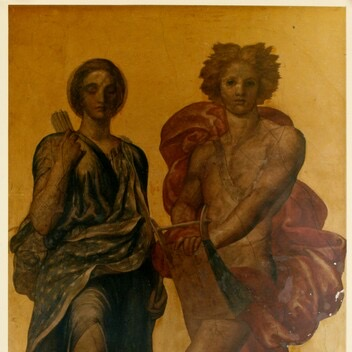
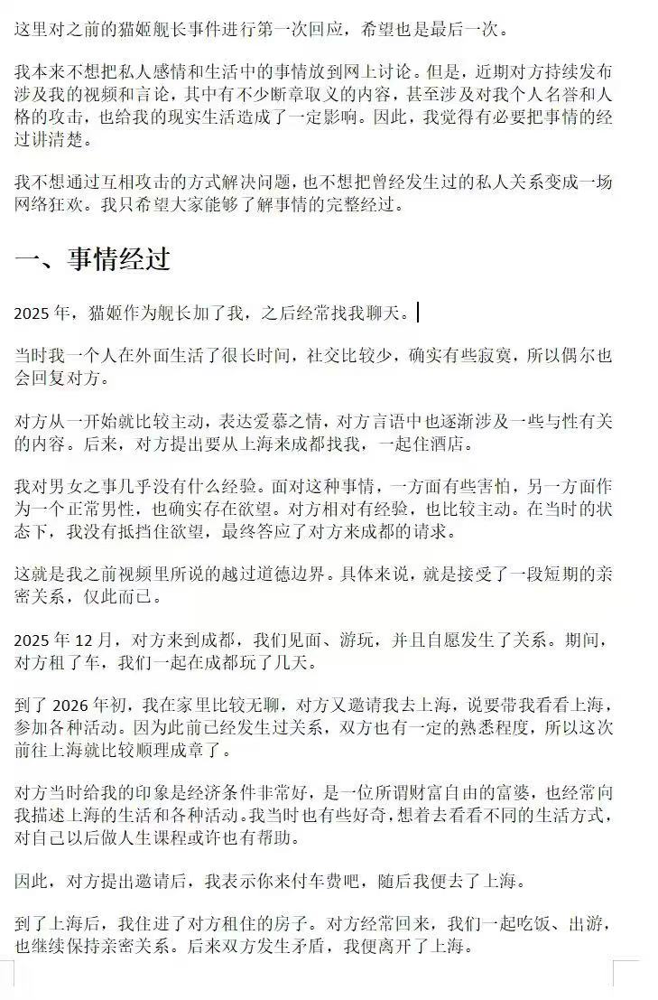
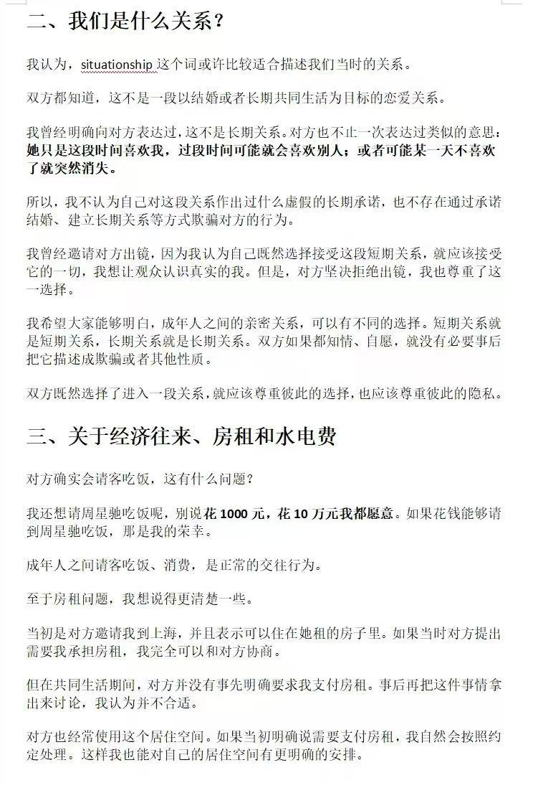
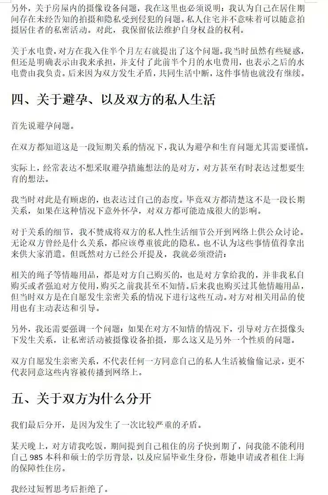
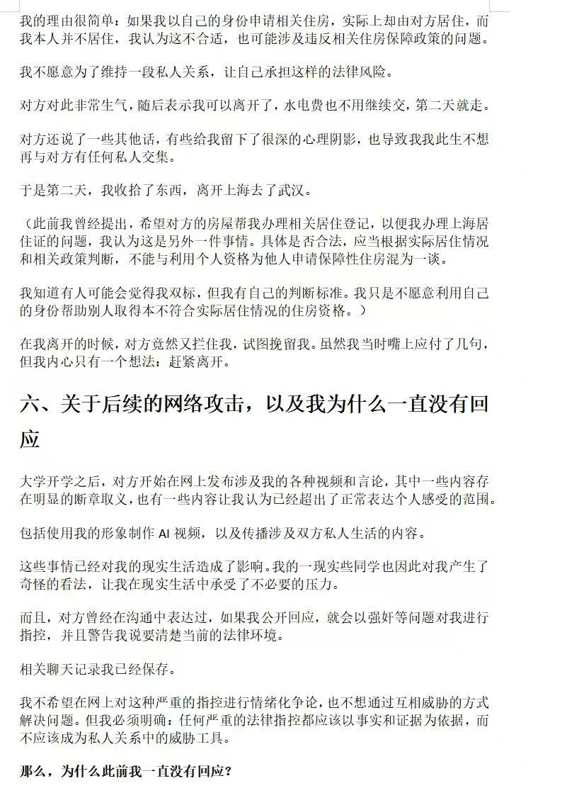
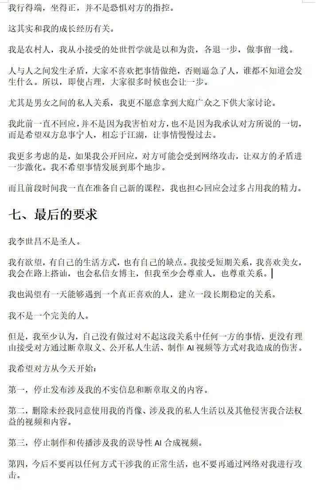
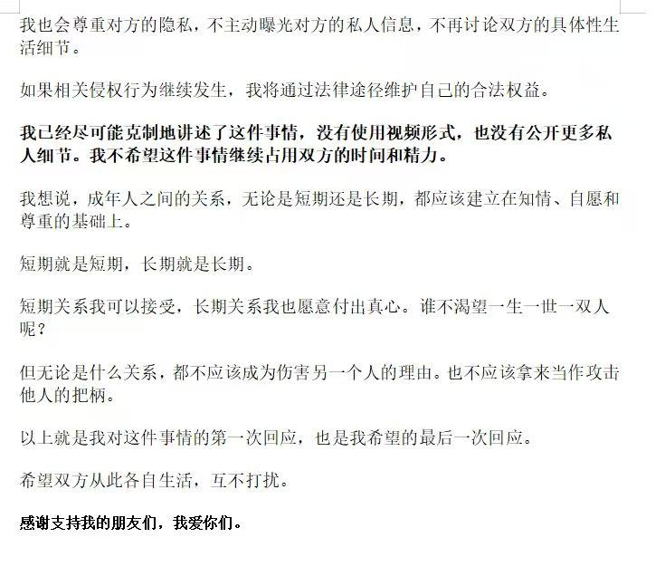

# 2026 年第 46 周

## 2026-11-09

神一定是有爱的

丘比特爱普续克
织女爱穷小子牛郎
……

都印证了神是有爱的

相反的 从来没有哪位哲学大师说过 或是规定过 神没有爱 他们普遍认为神的爱是一种 最高层次的爱 是 
无条件的 超越人类狭隘算计的创造与救赎

也印证了神是有爱的

娶亲先看娘 嫁夫先看家

古语云 不欺暗室 方为真善

祸福无门 为人自招

没有人能阻止我成为什么样的人 只有我自己能阻止我

## 2026-11-10

我对AI的看法

AI现在还只是一个写东西的工具 

他还不具备工程师对这个广博的世界的各种各样的理解和认识 

他做的项目 写的东西 

没有看出一点工程师的责任和担当 

做出来的东西也没有一点工程师的爱

现在的AI还只是机器 

我们有物理工程师 数学工程师 力学工程师 化学 材料 生物 土木 机械…..工程师 你湖也太厉害了

和AI聊这些的时候我只能说他太能编了 总体感觉就像跟木头人聊一样

（opus5.5 GPT6astra Gemini 4 argon）

## 2026-11-11

## 2026-11-12

流体力学期中考了84 这周末要接着考机械设计 理论力学和量子力学了 发发力孩子们 我要上90！

## 2026-11-13

继续发力 我要考100！

黄仁勋离开英伟达了 哎 老黄糊涂啊

