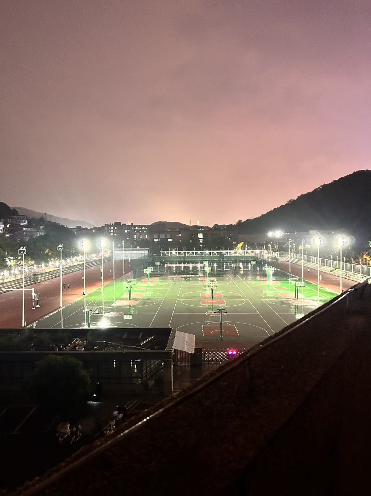
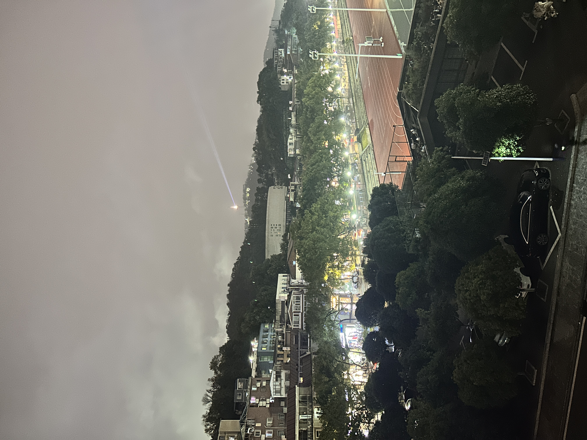

# 2026 年第 47 周

## 2026-11-16

两个待做的事情

1 做音乐同步播放器

2 做鲸鱼娘 GPT龙娘 Claude娘的表情包 然后上传到微信公众平台审核

做表情包真难啊 我好像前两天有想法忘记记录了 但是现在想不起来了 没招

做这个表情包真难啊 想是一回事 做是另一回事 不知道最后微信表情包平台能不能给我审核通过

我要使用语音打字了，这语音打字应该可以节省我很多时间 

刚才放学回宿舍的时候看到一个本科生开车上下学 真的逆天

## 2026-11-17

被你离开的 反作用力 锁进黑暗陷阱 一样的月光怎么看的我越来越心慌 你留下最清楚的步伐 竟是指引我孤单的方向

---

1102年，北宋词人贺铸回到了苏州那个阔别多年、早已破败的故居。

院子里长满了杂草，他轻轻推开门，里面竟有一盏微弱的烛光。

烛光旁，有一个女人，正低着头缝补一件衣裳。

女人听见动静，抬起头看过来，眼睛一下子亮了，声音里带着压不住的欢喜：“相公，你回来了。”

她站起来，贴近贺铸，像是有说不完的话，絮絮地跟他说着家常：“今天家里的盐吃完了，粮食也不多了。不过你别担心。明天儿子要去给邻居挑水，我再却接些女工的活，就足够买盐了。”

贺铸站在门口没有动，眼眶一点一点红了。泪，无声砸下来。

他没说话，只是慢慢把自己身上的衣裳脱下来，双手捧着，递过去。然后用微微嘶哑哽咽的声音道：“我的衣裳破了。你……还能帮我补吗？”

女人笑了，带着一点嗔怪的语气道：“相公在说什么呢，我是你的妻子呀。”

说罢，她伸手来接那件衣裳。

就在这时，一阵风从破窗里灌进来。

烛火，灭了。

贺铸定睛看去。

哪里有什么烛光，又哪里有什么妻子。

入目的，只有一张空床，满墙的蛛网和积了厚厚一层灰的窗棂。

这就是一间冷得透骨的旧屋。

他退出房门，外面，还下着雨。

雨打在瓦上，打在荒草上，打在他脸上。

泪，混着雨水，一滴一滴往下落。

贺铸望着天，他想不明白。

老天若有悲情，尚且可以借一场雨，把愁绪洒完、排尽。

可他贺铸，这一腔愁又该往哪里排？向谁去说呢？

贺铸，字方回，卫州共城人。他是才华横溢的词人，但却长得很不好看。

史书写他毫不留情：“长七尺，面铁色，眉目耸拔。”当时人还给他起了个外号，叫“贺鬼头”。

可他出身并不低，他是宋太祖贺皇后的族孙。只是传到他这一代，早败了，空有一个皇亲的名头，家里，可以说是一穷二白。

十七岁那年，他来到汴京，靠恩荫补了个右班殿直，一个最底层的武官。说难听点，就是看库门的。

可他心里的理想，不止于此。他想去边塞，想在一场真正的仗里，杀敌，立功，封侯。每每酒酣耳热，他拍着案子谈兵，眼睛里全是光。

但这终究是一场梦，因为北宋重文轻武，武官在许多人眼里，不过是个被使唤的粗人，根本没人在乎他那点雄心。

这场从少年就有的游侠快意的梦，很短，短到像没做过一样。

这也是他一生的第一重愁——志愁。志意不伸，一肚子热血，无处施展。

二十岁时，贺铸祖坟冒了青烟。他竟然娶了宋朝宗室济国公赵克彰的女儿赵氏。

两人论门第，勉强算门当户对，可要是论家境，贺铸一穷二白，官卑又貌丑，根本配不上赵氏。

但赵氏没嫌弃，不仅没有悔婚，嫁过来后甚至没提过一句委屈，对长辈也如自家父母般孝顺。

后来，由于贺铸是个武官，经常需要外任，天南海北到处跑，干得全是吃力不讨好的活。

赵氏怕他一个人在外没人照看。怕他衣裳破了，自己都不会补。

于是她也收拾了包袱，跟贺铸一起走。

那些年的漂泊的苦，两个人也一起吃遍了。在滏阳任上，贺铸穷困潦倒，他诗中这样写道：

“日俸才百钱，盐齑犹不供。”
“出门欲贷乞，羞汗难为容。”

一天俸禄才百来钱，连盐都吃不起了。想出门去借一点，却又丢不起那个人。

赵氏不想让贺铸自责，而是安慰他，明天儿子挑水，她做女工，会好起来的。

贺铸看着她，看着那双原本该拈香、该抚琴的手，在灯下为他补衣，一句话都说不出。

这些年，正是赵氏，替他把冰冷的日子，捂出了一点暖。

后来，贺铸弃武从文，通判泗州、太平州。生活稍微好了些，但他性子太刚，不肯攀附上级，还是在地方沉浮，一年一年，辗转江淮之间。

那时候，最让他感到折磨的，是乡愁。

在河北时，他写：“连夜不妨频梦见，过年惟望得书归。”

每夜不妨多梦见几回家吧，因为过年时只能盼望着等来一封家书。

在徐州任上，他又写：“故园又负黄华约，但觉秋风发上生。”

本和家里约好了，重阳一同看菊，又错过了。秋风一起，一根一根白发从鬓边生出来。

人总在路上，而家，总在远处。这也是他人生的第二重愁——乡愁。

那时，他以为，人生最苦，不过如此了。但他万万没想到，后半生还有一重愁在等他，并且终身都受困其中。

贺铸四十八岁那年，母亲去世了，他当即辞官丁忧，带着赵氏在苏州阊门附近安了家。

漂泊了半辈子，这是他们头一回，真正停下来。

屋子很旧，钱依旧不宽裕，可院子里妻子陪伴，有子女绕膝，案头有书，两三旧友偶尔拜访。

虽然平静如水，却是贺铸一生中最难以忘怀的日子。

两个人甚至开始想往后的事，想再种点什么，想等他丁忧完之后，就这么住下去也好。

然而天不遂人愿，没过几个月，赵氏病了，疾病来得急，药石无医。

赵氏就这么走了，他没能把她留住。

那天下起了梅雨，贺铸独自走在大街，任由雨水模糊了他的双眼。

不久后，贺铸安葬了赵氏，锁上了门，然后就离开了苏州这个伤心之地

他去了汴京。当时他的词，已经流传很广，得到朝野内在的欣赏。朝廷也重新起用了他，一切，看上去都在往好里走。

可怪就怪在这里，日子越顺，他却越想她。

数年之后，已经功成名就的贺铸借着机会，又回了苏州阊门的故居。

然后就是开头那一幕。往事在恍惚之间重现，又在一阵风后，消散一空。

那天同样下了场雨，贺铸写下了一首词，《鹧鸪天·半死桐》。

重过阊门万事非，同来何事不同归。
梧桐半死清霜后，头白鸳鸯失伴飞。
原上草，露初晞。旧栖新垅两依依。
空床卧听南窗雨，谁复挑灯夜补衣。

最后一句，最让人心疼。

雨还是那场雨，南窗还是那扇南窗，只是床空了，灯灭了，再无人给我补衣了。

贺铸的志愁与乡愁，还有解开的机会，可这一层人愁，却是生死之憾。解不开，也无处还。

史书说，贺铸此后终身没有续娶，因为他的人生，早已被困在了那个有赵氏的梅雨季节了。

贺铸晚年的诗词，总是在为一个人而写。比如《浣溪沙》，“记得西楼凝醉眼，昔年风物似如今，只无人与共登临。”

比如《青玉案》，“凌波不过横塘路，但目送、芳尘去。试问闲愁都几许？一川烟草，满城风絮，梅子黄时雨。”

别人读，读的是“闲愁”两个字。他写的时候，心里也只有两个字。

无人。

再无人矣。

1108年，五十八岁的贺铸正式辞官，回到了苏州隐居。

当时家里藏书万卷，他每天就埋在典籍里，校书、读史、填词、写字。还和书法家米芾往来，论帖，论墨，论一笔到底的锋。

日子清闲，却不枯燥。可丧妻的那份孤寂，一日复一日，缠着他。

书翻到某一页，会停住。雨落到南窗，会停住。西楼登到一半，会停住。

家中有万卷书，却填不满一张空床。

1125年，贺铸七十四岁，客死于常州一座寺庙的僧舍。临终前，他只留了一个遗愿：与赵氏合葬，葬在宜兴清泉乡东筱岭。

他漂泊了一辈子，而最后，要回到她身边，同穴而葬。

我曾到访过无锡宜兴市丁蜀镇，想探访贺铸与妻子的合葬墓，但得知其早已经消失在了茫茫山野之间，无处追寻了。

那天也正好下着雨，我突然悟到了什么。

贺铸一生落笔皆愁，壮志、乡愁终可释怀，唯有曲终人散，再无弥补的机会。

他也用二十六年证明，世间最痛的是，从不是清贫或漂泊，而是曾经有人为你缝补岁月、温暖余生，你却来不及好好相守。

千古词作虽然动人，却终究是余生的空念罢了。

所以，还请，珍惜眼前人。

---

贺铸的故事

我觉得可以发明一种点角式的二维坐标系 因为平面上任意一点到两个确定点之间的连线夹角是确定的 然后又因为同弧所对的圆周角相等 用圆来构造 应该能省很多事情

## 2026-11-18

等会儿考量子力学期中考试了 材料力学期中考了77 我真的服了 考的屎一坨 平均分70 最高96

奥 我知道了 我开始自己思考问题 走自己的路的时候 就走出了YJX的阴影了

## 2026-11-19

又想起来 我昨天晚上上课的时候 左右两边做了两个男的 人家俩在这 一坐就是坐三个小时 动都不动一下的 我想出去上厕所都不好意思开口

## 2026-11-20

这综合楼的男厕所里有个男的怀里不知道抱着什么东西 站在男厕所镜子前面 一直小声自言自语

## 2026-11-21

## 2026-11-22

这两天都没啥写的

再也没有人骂我了 再也没有人说我这做的不对 那想的不对了 难道我真的就做的对了 想的对了吗 不见得 但是再也没有人会指导我了 因为指导我的指导的也不一定对 

来看两套湖师大真题

你评价一下 难度怎么样 给你饭两天机械原理的书 你能考140吗

看了下齿轮，题目挺实用，得理解基本原理才会做，齿轮题也不偏，都是工程常用的概念

爸也就只会做和齿轮相关的

NGW齿轮的速比计算都考了

逆天 那速比计算不都是最简单的带公式题吗

定轴轮系带i12=n1/n2 行星轮系带i12H=（n1-nH）/（n2-nH）

就这两个公式 还能有啥公式 然后就是简单判断一下转动方向 看用不用乘个-1

iahb =1+zb/za
这是NGW行星的速比计算公式

一样的

与减速比计算直接用齿数，没必要用转速，转速易出错
减速比计算直接用齿数，没必要用转速，转速易出错

对啊 就是用齿数算

好了 上次勾的机械原理30道题做完了

感觉就那样吧

做完感觉也没啥 跟喝水一样

说明你还没做出门道，仔细对下答案，不明白的地方查查书，把道理融会贯通

就那样吧有啥门道 现在NS方程 黎曼猜想 GPT和Claude都能秒了

对面感觉是20世纪初的轮船和军舰 这边的AI感觉跟洋务运动的北洋海军没区别

我发现我身边真的有人是近之则不逊 远之则怨 真的是这样真的傻逼 远离这种人好吧

得寸进尺、人心不足蛇吞象

救急不救穷

躬自厚而薄责于人,则远怨矣

己所不欲,勿施于人

行有不得,反求诸己

感觉国外的 AI 现在像是坚船利炮啊。然后我们这边的 AI 现在像是。洋务运动的那种北洋海军吧。然后那 Kimi 的老板杨植麟那就是。洋务派嘛就是。曾国藩，然后 DeepSeek 的老板梁文锋那就是。当时的李鸿章

只是照着抄对面的器物，还抄不到项上

不过这个霸王茶姬的。万里木兰确实挺好喝的

一定要喝那个最冰的那一档

不要喝热的，热的没感觉

看，这是湖南大学印马塘操场

这是长沙岳麓山。下面是超算中心，上面的亮光是岳麓山顶的电视塔

人家当时木兰出征的时候，还万里赴戎机，关山度若飞。将军百战死，壮士十年归。看人家写的多好

我记得当时老师讲这个百战和十年 还是用的夸张和借代的修辞手法

我现在觉得一切的数学、物理，还有机械、化学、生物这些所有的知识都是可视化的，我要回去和我的 GPT 一起。把它们全都做出来

有的事情想到了，并且去做

不做永远是零

和没想到没有区别

应该是 有的事情想到了 就要去做

再也不理YHJ了 这种纯SB来的 无法相处 好吧 这种人真的恶心 道理说的真对 近之则不逊 远之则怨 升米恩 斗米仇

再见c

大家都是成年人了 该懂的道理都是默认要懂的 不懂的基本是废了

